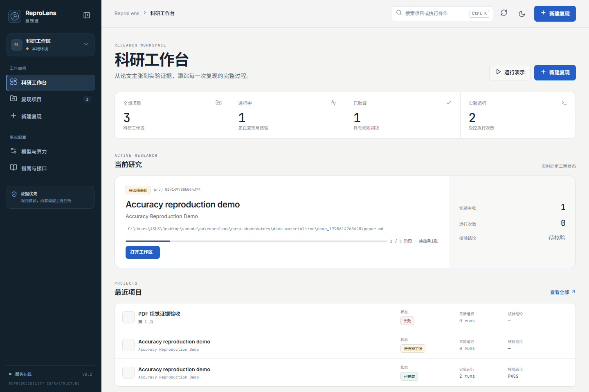

# ReproLens（复现镜）

ReproLens 是一个用 **TypeScript / Node.js** 实现的“主张驱动”论文实验复现 Agent。它不把“代码能跑”当成“论文复现成功”，而是把论文主张、实验计划、受控执行、失败诊断、代码实现委派、人工审批、规则核验和证据包串成一条可审计闭环。



## 核心闭环

```text
原始 PDF + 代码仓库 + 数据
        ↓
INIT / INGEST / CLAIMS
        ↓
PLAN（主张 → 数据 → 脚本 → 参数 → 指标）
        ↓
SANDBOX / EXECUTE（local / Docker / SSH）
        ↓
失败 → DIAGNOSE → CodeAgent 实现/修复 → 人工审批 → RETRY
        ↓
VERIFY（TypeScript 规则计算，模型不能写 verdict）
        ↓
主 Agent 中文总结 → HTML / Markdown 报告 + ZIP 复现包
```

## 当前能力

- 原始 PDF 直接输入，保留逐页文本与页面 PNG，不粗暴转文字。
- 从论文中提取可测量 claim，支持人工校正与选择。
- 生成受控实验计划，记录命令、镜像、工作目录、seed 和指标规则。
- 执行器只保留 **本机 / Docker / SSH** 三种模式。
- 失败后自动诊断；需要实现代码时可委派给 Codex、Claude Code、Gemini 或自定义 CLI CodeAgent。
- CodeAgent 在隔离副本中工作，只返回 diff；补丁必须人工审批后才能应用。
- 最终 `PASS / DIFFERENT / INSUFFICIENT_EVIDENCE / FAILED` 只由确定性规则计算。
- 主 Agent 根据事实 JSON 生成中文报告总结，明确标注模型、生成时间和来源。
- 报告可渲染为现代化 HTML 文档，支持打印 / 导出 PDF；证据索引只列运行日志、补丁与 CodeAgent 证据，不再展示原始论文或论文页面图像。
- Web 控制台展示完整流式执行过程、项目状态、claim、plan、run、patch、verdict、报告和证据包。

## 技术栈

| 层 | 选型 |
|---|---|
| 运行时 | Node.js 22+，推荐 Node.js 24 |
| 语言 | TypeScript 5，`strict` 模式 |
| HTTP / UI | Fastify + 原生 HTML/CSS/ESM 控制台 |
| 持久化 | better-sqlite3（项目聚合 + 追加式事件日志） |
| 模型 | OpenAI-compatible Chat Completions；支持多模态页面图像 |
| PDF | `pdfjs-dist` 文本抽取 + `@napi-rs/canvas` 页面渲染 |
| 归档 | tar.gz 工作区归档 + adm-zip 证据包 |
| 测试 | Vitest（15 个测试文件，45 个测试） |

## 不可破坏的约束

- `PASS / DIFFERENT / INSUFFICIENT_EVIDENCE / FAILED` 只由 `src/tools/verify.ts` 的数值规则计算。
- CodeAgent 只能在隔离副本中工作，返回统一 diff；不能直接改原始工作区。
- 补丁必须经过路径校验、证据记录和人工审批才能应用。
- 论文期望值、数据划分、指标定义和容差不能被代码 Agent 修改。
- 本机 runner 只用于演示/测试；真实隔离执行优先使用 Docker 或 SSH。
- 每次运行保存命令、退出码、耗时、stdout/stderr、环境、GPU、provider、job id 和日志路径。
- PDF 页面图像继续作为视觉证据归档，但不进入报告“证据索引”正文。

## 可切换能力

| 能力 | TypeScript 接口 | 已实现 |
|---|---|---|
| 论文理解 | `src/agent/analyzer.ts` → `Analyzer` | Heuristic、OpenAI-compatible、Fallback、主 Agent 报告总结 |
| 执行器 | `src/tools/runner.ts` → `Runner` | local、Docker、SSH |
| 代码实现器 | `src/codeagent/code-agent.ts` → `CodeAgent` | Mock、通用 CLI、Codex/Claude/Gemini 预设 |
| 状态存储 | `src/store/store.ts` → `Store` | Memory、SQLite |
| 编排 | `src/orchestrator/orchestrator.ts` | 确定性状态机、预算、审批、停止 |
| 报告 | `src/tools/report.ts` + `src/httpapi/report-page.ts` | 中文 Markdown、可打印 HTML、ZIP 证据包 |
| 交互 | `src/httpapi/server.ts` + `src/cli.ts` | Web 控制台、HTTP API、CLI |

## 快速开始

### 一键启动（Windows）

双击 `start.cmd`，或在 PowerShell 中运行：

```powershell
.\start.ps1
```

脚本会：

1. 检查 Node.js；
2. 首次运行自动安装依赖；
3. 创建 `.env`（如不存在）；
4. 启动 Fastify 服务；
5. 健康检查通过后打开浏览器。

如不需要自动打开浏览器：

```powershell
.\start.ps1 -NoBrowser
```

### 手动启动

```powershell
npm install
npm run typecheck
npm test
npm run build
npm run serve
# http://127.0.0.1:8080
```

## 模型配置

`.env.example` 提供模板。最小配置：

```env
REPROLENS_LLM_BASE_URL=http://127.0.0.1:8788/v1
REPROLENS_LLM_API_KEY=replace-me
REPROLENS_LLM_MODEL=deepseek-v4.1-flash
REPROLENS_LLM_TIMEOUT=60s
REPROLENS_LLM_VISION=true
```

也可以在 Web 控制台的 **模型与算力 → 模型接入** 中填写并保存。保存后：

1. 立即替换当前 Orchestrator 的 Analyzer、Runner、CodeAgent；
2. 写入 `data/settings.json`；
3. API Key 在读取时只返回掩码，留空保存会保留原 key；
4. 可用“测试连接”调用 `/api/v1/settings/test-llm`。

本地模型服务仅用于通路和功能测试；`.env`、`data/`、`data-*/` 和 `.work/` 不会进入版本控制。

## PDF 视觉摄取

`src/tools/paper.ts` 使用现成的 `pdfjs-dist` + `@napi-rs/canvas`：

1. 从 PDF 提取逐页文本；
2. 按页渲染 PNG（默认 1.5x，最多 1800px 宽）；
3. 保留 `Figure / Fig. / Table / 图 / 表` 等 caption 候选；
4. 生成 `PaperPage[]` 与 `PaperVisual[]`；
5. 若 `REPROLENS_LLM_VISION=true`，Analyzer 会把页面图像作为 `image_url` 发送给多模态模型；
6. 模型不支持图像或请求失败时，自动回退到文本提示，但页面图像仍保留在证据包中。

## 执行器

### Local

- 单行命令白名单；
- 工作目录必须位于 workspace 内；
- 可选 CUDA 环境变量；
- 仅建议在回环地址演示使用。

### Docker

- `--network none`；
- `--read-only`；
- 内存、CPU、PID 限制；
- `--cap-drop ALL` 与 `no-new-privileges`；
- GPU 开启时追加 `--gpus all`。

### SSH

- `scp -O` 上传 tar.gz 和运行脚本；
- `ssh` 远程解压并执行；
- 支持 WSL / dropbear 验证；
- 记录 remote job id、GPU 与 stdout/stderr。

## CodeAgent 委派

可以。当诊断标记 `needs_code_agent` 且没有现成补丁时，Orchestrator 会：

1. 将工作区复制到 `evidence/codeagent/<run-id>/workspace-*`；
2. 初始化 git baseline；
3. 生成受约束的开发任务，包含论文、claim、计划、失败输出和诊断；
4. 调用配置的代码工具（Codex / Claude Code / Gemini / 自定义 CLI）；
5. 可选执行验收命令；
6. 用 git 生成统一 diff；
7. 校验 diff 路径与新增文件；
8. 将补丁置为 `proposed`，等待人工审批。

CodeAgent 不会直接写原始工作区，也不会写最终 verdict。Web 控制台的“执行与代码 Agent”面板可开关 CodeAgent、选择工具、配置命令、超时和验收开关。

## 主 Agent 报告总结

项目完成规则核验后，Orchestrator 会调用当前配置的主模型生成中文报告总结：

- 总结只使用项目事实 JSON：claim、计划、运行、指标、补丁、证据元数据；
- 总结必须原样引用规则 verdict，不能重新计算或覆盖；
- 模型失败时自动回退到确定性中文总结；
- 报告持久化模型名、来源和生成时间；
- 可在报告 HTML 或项目工作区点击“重新生成主 Agent 总结”。

报告 HTML 包含：

- 项目、论文、工作流、生成时间和总结模型；
- 规则 verdict 与期望值 / 观测值 / 绝对误差；
- 主 Agent 总结；
- 实验主张、实验计划、运行记录、补丁审批、关键事件；
- 精简证据索引（stdout/stderr、补丁、CodeAgent 日志）；
- 打印 / PDF 样式和响应式布局。

## Web 控制台

控制台采用面向科研工作流的设计：

- 工作台展示真实项目统计、当前研究与最近项目；
- 项目工作区提供六阶段复现轨道、实验主张、计划、补丁审批与规则核验；
- 执行过程页签展示命令启动、stdout/stderr 流、诊断、补丁、核验和报告事件；
- 论文页签直接渲染原始 PDF 页面缩略图，并支持大图查看；
- 报告页签以 iframe 展示可读 HTML 报告；
- 模型与算力分为模型接入、执行与代码 Agent 两组；
- 支持浅色/深色主题、可折叠侧栏、`Ctrl/Cmd + K` 命令面板、键盘焦点与 reduced-motion；
- 1440 / 1024 / 390 / 320 宽度均通过无横向溢出检查。

界面证据：

- `docs/observatory-overview-final.png`
- `docs/observatory-settings-execution.png`
- `docs/observatory-report-1440.png`
- `docs/observatory-report-1024.png`
- `docs/observatory-report-390.png`
- `docs/observatory-real-transcript.png`
- `docs/observatory-real-verification.png`
- `docs/observatory-real-evidence.png`

## 真实案例

已使用 2024 年 Grokfast 官方仓库完成真实复现：

- 论文：Lee et al. (2024), *Grokfast: Accelerated Grokking by Amplifying Slow Gradients*，arXiv `2405.20233`。
- 官方代码：`ironjr/grokfast`，MIT。
- Claim：Grokfast EMA 配置在模块乘法 Transformer 任务上约 910 次迭代达到 95% 验证准确率，容差 ±300。
- 本机验证环境：RTX 4060 Laptop；项目报告记录观测 `iterations=900`，规则判定 **PASS**。
- 报告：`examples/grokfast/report.md`；证据包：`examples/grokfast/evidence/grokfast-reproduction-package.zip`。

详细说明见 `docs/real-paper-test.md`。

## CLI

```powershell
# 本地端到端 demo：失败 → 补丁 → 审批 → 重跑 → PASS
npm run demo -- --auto-approve

# 检查本地 OpenAI-compatible 接口
npm run check-llm

# 启动 Fastify 控制台
npm run serve

# SSH 部署探针
npm run ssh-demo -- --host asus@127.0.0.1 --port 2222 --identity .work\ssh\reprolens_wsl_rsa --base-dir /home/asus/reprolens-test --gpu
```

## HTTP API

核心接口见 `docs/api.md`，包括：

```text
GET  /api/v1/projects
POST /api/v1/projects
POST /api/v1/uploads/paper
POST /api/v1/uploads/repo
POST /api/v1/projects/:id/start
POST /api/v1/projects/:id/claims
POST /api/v1/projects/:id/plan/confirm
POST /api/v1/projects/:id/patch/approve
POST /api/v1/projects/:id/patch/reject
POST /api/v1/projects/:id/stop
GET  /api/v1/projects/:id/events/stream
GET  /api/v1/projects/:id/report.md
GET  /api/v1/projects/:id/report.html
POST /api/v1/projects/:id/report/summarize
GET  /api/v1/projects/:id/package
GET  /api/v1/settings
PUT  /api/v1/settings
POST /api/v1/settings/test-llm
```

## 目录

```text
src/config.ts               环境变量与配置校验
src/runtime.ts              Analyzer / Runner / CodeAgent 构造与运行时设置持久化
src/agent/                  启发式、OpenAI-compatible、回退分析器与报告总结
src/codeagent/              CodeAgent 接口、Mock、CLI 适配器
src/domain/                 状态机与领域类型
src/orchestrator/           确定性编排、审批、停止、预算
src/store/                  Memory / SQLite 存储
src/tools/                  PDF、仓库、workspace、runner、patch、verify、report
src/httpapi/                Fastify API、HTML 报告与静态控制台
public/                     Observatory 科研工作台 HTML/CSS/JS
tests/                      Vitest 单元与集成测试
examples/                   真实案例与复现脚本
docs/                       架构、接口、真实案例与界面证据
start.cmd / start.ps1       Windows 一键启动脚本
```

## 测试

```powershell
npm run typecheck
npm test
npm run build
node --check public\app.js
git diff --check
```

测试覆盖状态机、SQLite、事件序号、claim 抽取/去重、PDF 页面视觉证据、补丁路径与新增文件、GPU 参数、SSH 参数、CodeAgent diff、规则核验、主 Agent 总结、报告 HTML/ZIP、运行时设置和端到端 demo。

## 安全与限制

- 首版主要面向轻量 Python 项目，不承诺任意学科或大规模 GPU 论文。
- CodeAgent 的真实效果取决于所接代码工具的权限、模型和网络环境。
- 人工审批仍是强制门；自动审批只用于演示/测试。
- `.gitignore` 已排除 `.env`、`data/`、`data-*/`、`.work/`、`node_modules/`、`dist/`、日志和浏览器自动化产物。
- 本仓库不包含任何真实密钥；本地模型 key 仅保存在被忽略的 `.env` 或 `data/settings.json` 中。